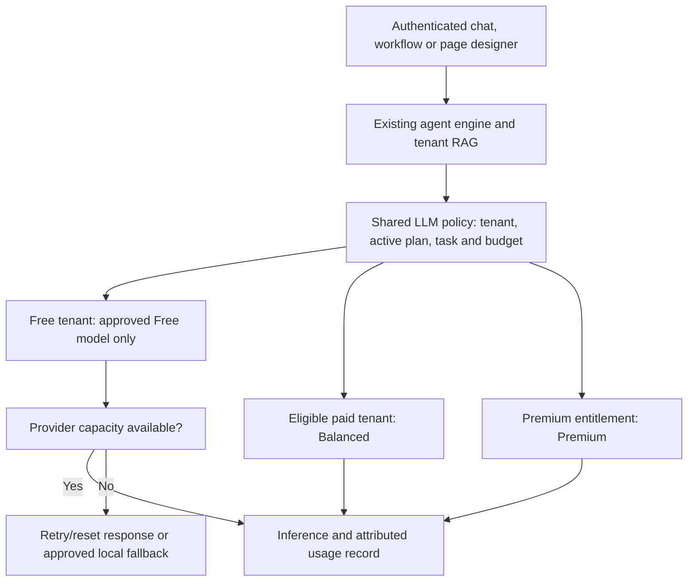

# FreeLLMAPI and OmniDome: viability and proposed integration

**Recommendation: build a Platform Owner model console in OmniDome and extend the existing Llama wrapper with three approved model choices and tenant-plan routing.** FreeLLMAPI offers useful interface and routing patterns. Its unmodified router is intended for personal use and lacks multi-tenant authentication/billing, so it is not ready to become OmniDome's customer backend. Its architecture documentation explicitly states that limitation. [Upstream architecture](https://github.com/tashfeenahmed/freellmapi/blob/main/docs/en/architecture/00-high-level-index.md)

This is a review and implementation proposal. No provider was installed, no credentials were changed, and no tenant traffic, billing or credit policy was changed. The tenant bring-your-own-key proposal is cancelled; provider credentials would be managed by the Platform Owner.

## What the project is made of

| Part | Implementation | Fit for OmniDome |
| --- | --- | --- |
| Dashboard | React, TypeScript, Vite, Tailwind, React Router, React Query and Recharts | Rebuild/adapt useful components inside our existing Next.js app and design system |
| API gateway | Node.js and Express, OpenAI-compatible endpoints | Can be called by our Python backend; cannot replace tenant authentication or the agent engine |
| Storage | SQLite; encrypted provider credentials | Fine for a private evaluation instance; our tenant policy and usage records should remain in Postgres |
| Routing | Capability filters, health, quotas, ranking, cooldowns and failover | Start with a small deterministic policy for our three models; add observed performance ranking later |

The dependencies are documented in the [client package](https://github.com/tashfeenahmed/freellmapi/blob/main/client/package.json) and [server package](https://github.com/tashfeenahmed/freellmapi/blob/main/server/package.json). Its [router implementation](https://github.com/tashfeenahmed/freellmapi/blob/main/server/src/services/router.ts) filters capabilities including tools, context size and structured-output compatibility before selecting providers.

The code is MIT licensed: copied or adapted portions must retain the required copyright/permission notice. That software licence does not grant rights to reuse an upstream provider's accounts, model licences or free quotas. [Licence](https://github.com/tashfeenahmed/freellmapi/blob/main/LICENSE)

Its Models, Keys, Playground and Analytics pages are useful references. The project's Premium purchase pays for a fresher model-catalogue feed; it is not a purchase of premium-model inference. OmniDome does not need Stripe or that subscription to build this feature. [Project README](https://github.com/tashfeenahmed/freellmapi#premium-live-catalog)

Source inspection was pinned to commit `986b2118226f5c2d1a0348e14d151a7005c1924e`. The project was not installed or load-tested, and its dashboard was not tested interactively.

## Can Free tenants use it without costing us money?

We can aim for **zero external LLM inference charges within an approved provider's free quota**. We cannot promise zero operating cost: hosting, database work, RAG, monitoring and local inference still use resources. Nor does a free chat model make Deepgram calls, AgentMail/email, Firecrawl research or other paid tools free.

All Free tenants share the capacity of the platform's provider account. Adding keys does not necessarily add capacity. Groq documents organisation-level limits; OpenRouter says extra accounts/keys do not raise its globally governed limits. Its live key endpoint exposes remaining free-model requests. The dashboard should show observed quota and reset times, rather than an aggregate advertised token budget. [Groq limits](https://console.groq.com/docs/rate-limits), [OpenRouter limits](https://openrouter.ai/docs/api_reference/limits)

The provider matters. Groq's current agreement allows integrating APIs into customer applications for end users, and recognises fee-free services subject to limits. It is a reasonable candidate to evaluate, subject to the selected model's terms, account settings and capacity. [Groq agreement, sections 3.1 and 5.1](https://console.groq.com/docs/legal/services-agreement)

Data policy also matters for an ISP. Gemini's unpaid-service terms permit use of submitted content to improve products and warn against submitting sensitive, confidential or personal information. I would exclude that route from ordinary customer/CRM/billing RAG traffic under those terms. Groq documents configurable zero-data-retention controls. These are provider-specific differences, so a catalogue entry labelled “free” is insufficient approval for customer data. [Gemini unpaid-service terms](https://ai.google.dev/gemini-api/terms), [Groq data controls](https://console.groq.com/docs/your-data)

**When Free capacity is exhausted, return a clear retry/reset message or use an explicitly approved local fallback. Never silently switch a Free request to a paid model.** Keep per-tenant fair-use limits as well as the shared provider limits. Existing included credits can remain an application allowance; they are not upstream tokens or proof of remaining provider quota. This review does not change their allocation or selling price.

## What we already have

Live routing settings currently contain four Free OpenRouter model IDs:

- `nvidia/nemotron-3-nano-omni-30b-a3b-reasoning:free`
- `nvidia/nemotron-3-super-120b-a12b:free`
- `liquid/lfm-2.5-2.6b:free`
- `qwen/qwen3.8-27b:free`

These are configured IDs, not a claim that all four are available or suitable for every task. I did not call their providers during this review.

The relevant existing code is:

- [Agent Llama wrapper](C:/Users/Benedict/Desktop/OminiDome/omnidome/services/agent_orchestrator/llm.py): local Ollama, cloud fallback, model preferences and structured outputs.
- [Shared OpenRouter client](C:/Users/Benedict/Desktop/OminiDome/omnidome/services/common/openrouter.py): an environment fallback chain, concurrency limits and cooldowns.
- [Caller context](C:/Users/Benedict/Desktop/OminiDome/omnidome/services/agent_orchestrator/identity.py): currently accepts a requested-model preference. That preference needs a server-side plan allowlist before paid choices are introduced.
- [Usage analytics](C:/Users/Benedict/Desktop/OminiDome/omnidome/services/agent_orchestrator/routes/usage.py): existing model/token/cost records that can feed the new console.
- [Website designer](C:/Users/Benedict/Desktop/OminiDome/omnidome/services/portal_builder/design.py): calls the shared client directly and must follow the same plan policy.
- [JEV checks](C:/Users/Benedict/Desktop/OminiDome/omnidome/services/agent_orchestrator/jev_gate.py) and [long-horizon review](C:/Users/Benedict/Desktop/OminiDome/omnidome/services/agent_orchestrator/long_horizon.py): independent verifier calls also need cost classification. Choosing a free main model alone does not constrain those calls.

The reviewed routing is primarily agent/model-based, rather than subscription-based. There are also different streaming and non-streaming paths. Simply changing one global base URL would not establish a safe Free-tier policy.

## The three choices and the owner interface

Start with three configured reasoning-model slots. Each slot points to one selected provider/model; actual models are chosen and tested in the owner console. Existing RAG embedding models remain separate.

| Choice | Purpose | Customer routing |
| --- | --- | --- |
| Free / Basic | Approved no-charge inference with strict capacity limits | Free tenants; no paid fallback |
| Balanced | A production model with a bounded provider-spend allowance | Default for eligible paying tenants |
| Premium | The owner's higher-capability model | Only plans/workloads explicitly enabled for it |

The **Platform Owner**, with multi-tenant platform authority, gets **Models & Routing**. A tenant Owner/Org-Admin does not get provider-key access. Initially tenants have automatic backend routing; the owner has the three-choice picker.

| Owner tab | What it should show/do |
| --- | --- |
| Models | Three slots: provider, model, capability badges, context limit, health, price evidence, customer-use eligibility and last test |
| Routing | Assign defaults to Free/paid tiers; configure permitted fallbacks, request/token limits, timeout and provider-spend ceilings |
| Playground | Choose Auto or one approved model; show the requested and served model, tokens, latency, fallback reason and cost |
| Keys | Add/test/rotate/disable platform credentials; show masked labels after saving; never return raw keys to the browser |
| Analytics | Requests, successful/failed calls, latency, tokens, costs, quota pressure and fallback reasons by model and tenant |

The playground should use synthetic data by default. Production prompts should not become a broadly visible analytics log. New provider secrets need encrypted storage with the encryption key outside the database/repository. Every provider-admin endpoint needs a Platform Owner permission check; hiding a tab is not authorization.

## Proposed backend path

Keep memory/RAG, tools, human approvals, conversations and billing in OmniDome. Model selection happens inside the existing wrapper after verified tenant/plan resolution. If we evaluate FreeLLMAPI itself, it sits on a private network behind that wrapper, with a server-held unified key. Its dashboard/API keys are not exposed to Free tenants or through ngrok.

The shared policy must:

1. Resolve the effective plan from server-side provisioning, including modular purchases and trials. A pending Paystack order does not unlock a paid model; activation and downgrade change routing when the real entitlement changes.
2. Validate any requested model against that plan and purpose. Apply it to both streaming and ordinary calls, website generation, workflows, compaction and reviewers. Unknown identity/policy must not default to a paid route.
3. Check capabilities before routing: agent tools and workflow JSON require appropriate support. Preserve validators and approvals when a free model is weak or unavailable; do not replace an unavailable paid verifier with an automatic “approved” result.
4. Enforce tenant fairness, shared provider quotas and in-flight reservations. Bound retries so our wrapper and an optional gateway do not multiply one another's fallback attempts.
5. Record requested model, served provider/model, token usage, latency, observed cost and fallback reason against the tenant/run. Keep unreported cost distinct from confirmed zero cost.
6. Disable paid plugins/add-ons on the Free route. Treat optional multi-model synthesis as out of scope for the initial three-model setup.

## Integration options and delivery order

| Option | Assessment |
| --- | --- |
| Native console + extend our wrapper | **Recommended:** reuses our authentication, Postgres, usage ledger, memory and existing Next.js components; least duplicate platform plumbing |
| Private FreeLLMAPI evaluation gateway | Useful for owner-only provider experiments. Requires an adapter and capability/streaming tests; its own auth/analytics are not our tenant controls |
| Full fork and dashboard import | Possible under MIT, but creates ongoing work merging a separate React/Vite app, SQLite schema, auth and routing system |

I would deliver this in three steps:

1. **Owner-only console and three tested model slots.** Keep current tenant routing until model health, tool calling, JSON, streaming and quota behaviour are verified.
2. **Central plan policy and controlled Free pilot.** Test exhaustion with zero paid calls, forged model overrides, tenant isolation, unavailable reviewers, provider price changes and upgrade/downgrade transitions. Enable an approved provider/account for a small Free cohort.
3. **Paid defaults and operational analytics.** Connect actual paying entitlements to Balanced/Premium with spend ceilings and clear served-model feedback. Keep Paystack and the existing usage ledger.

FreeLLMAPI can therefore contribute to the design, and can be evaluated privately. For OmniDome customer traffic, the recommended implementation is a small, governed model-routing layer with an owner console—not an assumption that a large advertised free-provider catalogue is unlimited production capacity.

Memory was consulted before the review: the live recall returned three team entries and three company-knowledge hits with no error note. Provider credentials were not printed or copied. No production service was restarted.
