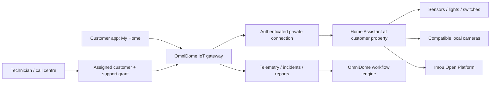

# Home Assistant for OmniDome customers

Reviewed 13 October 2026. This is an integration proposal and source review; no Home Assistant deployment, device pairing or product changes were performed.

## Recommendation

Use Home Assistant as the household automation engine and its own dashboard for advanced setup. Extend OmniDome's existing IoT service into the customer and support gateway. Deploy or connect one Home Assistant instance per customer property, with the ISP tenant managing its fleet through OmniDome.

Home Assistant supports authenticated REST operations, live WebSocket events and third-party application authorization. These are the bridge between the two products. [REST API](https://developers.home-assistant.io/docs/api/rest/), [WebSocket API](https://developers.home-assistant.io/docs/api/websocket/), [authorization](https://developers.home-assistant.io/docs/auth_api/).

## What already exists and needs correcting

The repository already contains `services/iot/ha_client.py`, encrypted Home Assistant tokens, connection testing and discovery/sync routes, devices, rooms, cameras, sensors, scenes, automations, alerts and events. The web has an IoT module. We should extend these components.

However, the current integration model has `tenant_id` but no customer/property ownership fields. Camera resolution chooses the tenant's primary or connected instance. `access.py` grants authenticated tenant members viewer access and uses tenant roles for control. Those boundaries are insufficient for a residential service: two customers of the same ISP must not share device access, and staff permissions must not automatically expose private camera feeds.

The technician's `site-iot.tsx` currently maps `TechDevice` records from the technician API, including fibre RX/TX power. It is not yet a customer Home Assistant support workspace. The WebSocket client exists, but the IoT startup code does not start it and the source search found no service caller subscribing to events. Live ingestion needs an actual worker lifecycle, reconnects and recovery sync.

## Customer and staff journeys

| View | Proposed experience |
| --- | --- |
| Customer app: My Home | Connect an existing Home Assistant or request an ISP installation; choose property; rooms, devices, sensors, scenes and permitted cameras; show connection status and last update; request help. |
| Full Home Assistant dashboard | Open the customer's own dashboard through a tested authenticated launch. Use it for pairing integrations and advanced automations. Start with a separate window; validate mobile WebView login, origin and WebSocket handling before embedding. |
| Call centre | Open the customer from a ticket; see gateway health, offline devices, battery warnings and recent faults. Request temporary access when more detail is needed. |
| Technician | Open the assigned job/property; connection checklist, device discovery, pairing assistance, diagnostics and verification. Customer-approved control and camera access expire when the support session ends. |
| ISP IoT panel | Fleet health, customer/property inventory, installations, incidents, support sessions, product entitlements and aggregate usage. |

OmniDome login does not automatically sign someone into Home Assistant. Its application authorization produces access and refresh tokens; a full dashboard launch has its own authentication behaviour. Do not distribute an administrator token to customer browsers or staff. The customer can revoke OmniDome support access independently of their own home controls. [Home Assistant authentication](https://developers.home-assistant.io/docs/auth_api/).

## Imou cameras and sensors

Home Assistant now documents an Imou integration using Open Platform App ID/App secret and matching account region. It exposes cameras and other entity types according to device capabilities. The device must be linked to the platform account; discovery does not grant ownership. Availability in the customer's installed Home Assistant version must be checked. [Official Imou integration](https://www.home-assistant.io/integrations/imou/).

Imou's own team also maintains a HACS integration with cloud access, device selection and optional alarm callbacks. Cloud API calls and video consume resource quota; some alarm-picture decryption needs separately obtained native libraries, currently documented for Linux x86-64. Validate those features before promising them on an ARM home gateway. Prefer the built-in integration where it supplies the required features. [Imou official-team repository](https://github.com/Imou-OpenPlatform/Imou-Home-Assistant).

For compatible cameras, test a local ONVIF path as well. Home Assistant supports Profile S and compatible H.264 profiles; support varies by exact camera and firmware. Local viewing may continue without Imou cloud, but remote OmniDome access still needs a working connection. [ONVIF integration](https://www.home-assistant.io/integrations/onvif/).

Do not promise zero-cost cloud camera service. Confirm Imou's account terms, device authorization/sharing, South African region selection and current API/video tariffs directly before selecting tenant credentials or retail prices. Keep customer accounts isolated; an ISP-wide credential must not expose every household's camera.

## Other devices and reporting

Use the Home Assistant ecosystem for additional brands and protocols. Initial candidates are Zigbee sensors via a compatible coordinator, Matter devices with the appropriate controller/network setup, and MQTT devices using authenticated discovery. Compatibility is device-specific; not every internet-connected device supplies an accessible integration. [ZHA](https://www.home-assistant.io/integrations/zha/), [Matter](https://www.home-assistant.io/integrations/matter/), [MQTT](https://www.home-assistant.io/integrations/mqtt/).

Keep household automation and detailed history local. Home Assistant Recorder provides history, with retention configuration; OmniDome should collect only the telemetry and aggregates needed for the selected service. [Recorder](https://www.home-assistant.io/integrations/recorder/).

Reports should distinguish device faults from gateway/internet failure and stale data. Include online availability, incident duration, low batteries, camera connectivity, sensor trends and supported energy consumption. Preserve units and timestamps; never turn unavailable readings into zero. Store video separately only if a recording product is explicitly purchased and authorized.

Proposed workflow events include `iot.device.offline`, `iot.device.recovered`, `iot.sensor.threshold_exceeded` and `iot.support.access_expiring`. These are new contracts to implement, not events verified as publishing today. First workflows should draft support tickets and notify owners; restarting cameras, unlocking doors and disabling alarms require specific authorization.

## Implementation order

1. **Ownership and support access:** add property/customer ownership to integrations, devices and derived records; scope every route and media request; bind customer identity from verified authentication; introduce ticket/job-bound, expiring support grants and audit logs. Resolve a device through its actual integration, removing the tenant-primary fallback for customer actions.
2. **One real household pilot:** connect an existing Home Assistant or an ISP-managed home gateway, one Imou camera and a small sensor set. Home Assistant OS is the recommended managed-installation candidate; compare Container requirements against needed companion services. Use a private outbound relay/VPN, rather than exposing household port 8123 or allowing arbitrary private-network URLs. [Installation options](https://www.home-assistant.io/installation/).
3. **Customer and support screens:** add My Home, dashboard launch, support request/revocation and assigned-property diagnostics. Test customer A/B isolation within one tenant, cross-tenant isolation, grant expiry and revocation during streaming.
4. **Continuous telemetry:** start/recover subscriptions, sync after disconnects, namespace entity IDs by integration, deduplicate events and record command outcomes. Test unavailable gateways, token expiry, duplicate entity names and motion/event handling.
5. **Products and reports:** align installations, device allowances, remote support, cloud video/storage and monitoring with catalogue/subscription entitlements. Meter external costs independently from AI credits. Ending a paid service should stop the paid remote features while preserving customer-owned local automation.

The first release should prove this customer-to-support journey with real hardware before expanding to a broad camera and sensor catalogue. No hardware connection, Home Assistant credentials, Imou developer account or production video path was available during this review, so those remain pilot prerequisites.
