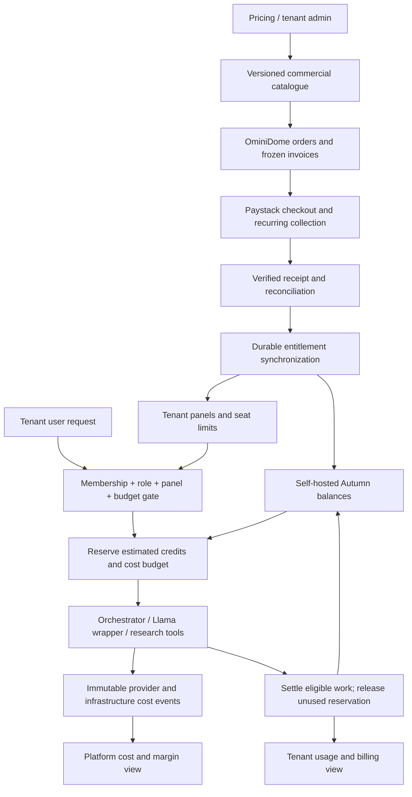

# OminiDome commercial architecture and product design

Design review dated 10 October 2026. This extends the tenant-pricing implementation and the proposed self-hosted Autumn integration. It does not activate new charges or change advertised prices.

## Recommended model

Sell **platform access + seats + included AI credits + separately measured services**. Keep the buying experience simple, while measuring the actual cost of delivering each operation internally.

A bundle buys a coherent set of panels; modular pricing buys selected panels. Both use the same commercial catalogue, role rules, invoice engine and Paystack checkout. AI credits are a tenant-wide pool with a versioned rate card. Hosting is included within declared capacity limits. Communications, exceptional storage/traffic and specialist compute have separate units and explicit budgets.

One completed chat turn should not automatically equal one credit. A short answer, a generated landing page and an hour of research have different cost profiles. Nor does a completed agent turn prove an ISP customer issue was resolved: resolution-based pricing needs a verified business outcome and a deduplication window.

The earlier suggested 100/1,000/5,000/20,000 action allowances are withdrawn as launch defaults. They were provisional, and were never applied. First reconcile the existing promises and define the unit economics.

## Relevant industry patterns

| Reference | Verified pattern | Application to OminiDome |
|---|---|---|
| HubSpot | Seats and product editions, included monthly credits, weighted actions, optional additional credit capacity | Separate panel access from consumption; publish a credit rate card; share the pool across modules |
| Shopify | Platform subscription, hosted storefront, tiered capabilities and staff access, separate payment-provider transaction fees | Include a sensible website-hosting allowance; show subscription and transaction costs separately |
| Intercom / Zendesk | AI support pricing linked to outcomes or automated resolutions | Use verified outcomes for customer-service automation once resolution detection is reliable |
| Paystack | Payment collection fees depend on payment method and locality | Account for real gateway fees in margins and settlement reconciliation |

HubSpot explicitly uses different credit rates for different work and says included credits across products are not additive. Its credits reset monthly. This supports a shared pool and weighted rate card; its commercial rates are not a suitable cost benchmark for OminiDome. Sources: [HubSpot catalogue](https://legal.hubspot.com/hubspot-product-and-services-catalog), [credit management](https://knowledge.hubspot.com/account-management/understand-hubspot-credits-and-billing).

Shopify's South African pricing page combines hosted commerce with plan capabilities and lists third-party payment-provider fees that vary by tier. OminiDome does not need to adopt a percentage of ISP revenue merely because Shopify uses transaction-based fees. Source: [Shopify South Africa pricing](https://www.shopify.com/za/pricing).

Intercom distinguishes several kinds of outcome and deduplicates outcomes within a conversation. Zendesk describes successful automated resolutions as its AI billing unit. OminiDome's general research and workflow agents need their own verifiable units. Sources: [Intercom outcomes](https://www.intercom.com/help/en/articles/8205718-fin-ai-agent-outcomes), [Zendesk pricing](https://www.zendesk.com/pricing/).

These are product patterns, not universal industry standards. Prices and policies were checked on the review date and can change.

## What costs money

| Cost centre | Actual cost driver | Customer-facing treatment | Internal control |
|---|---|---|---|
| AI inference | Model, input/output/cached tokens, retries, verification calls | Weighted AI credits; premium models can have higher rates | Model routing, token/step ceilings, per-job monetary budget |
| Research | Search queries, crawls, extraction, browser sessions, model synthesis | Research estimate and credit ceiling before launch | Provider-call limits, cached sources, bounded research depth |
| Agent execution | CPU/GPU seconds, memory, containers/sandboxes, concurrency | Included bounded runtime; dedicated execution capacity as an add-on | Job TTL, concurrency queues, cancellation, idle shutdown |
| RAG and memory | Parsing, embeddings, vector storage, database queries, re-indexing | Included document/storage limits; large ingestion as a quoted operation | Incremental ingestion, deduplication, retention and tenant quotas |
| Website hosting | CDN bandwidth, origin compute, assets, forms, domains, backups | Published pages/asset storage/traffic included within declared capacity | Static delivery, compression, rate limits and abuse protection |
| Core tenant data | Database capacity, backups, logs, records | Plan capacity or capacity add-on | Per-tenant accounting and retention; shared infrastructure allocation |
| Communications | Email deliveries, SMS segments, WhatsApp messages, voice minutes, recordings | Separate communication wallet or itemized usage | Consent controls, campaign limits, spend cap and provider receipts |
| Payments | Collection fees, refunds/disputes, transfer fees, settlement | Clearly disclosed billing terms; platform fee only if deliberately offered | Verified receipts, fee reconciliation and payment-method-aware estimates |
| Operations | Monitoring, incident response, support, onboarding and maintenance | Included support level; onboarding/dedicated support as explicit products | Shared overhead allocation and service-level costing |
| Autumn itself | Database, cache, queues, workers, backups and maintenance | Included platform overhead | Measure its footprint; keep isolated from the ISP billing database |

Ollama running locally has compute, hardware, electricity and operating costs even when there is no per-token vendor invoice. Unknown provider cost must remain unknown or estimated; it must not become a zero-cost financial entry.

ISP fibre subscriptions, FNO costs, routers and claw-back invoices are a separate business ledger from OminiDome SaaS fees. An ISP customer's R500 internet payment is not automatically OminiDome's platform revenue or AI budget.

## Architecture

OminiDome owns identity, tenancy, roles, commercial contracts, invoices and provider receipts. Autumn owns feature balances and atomic credit reservations. Paystack owns collection. The worker translates verified commercial events into Autumn grants; it never substitutes Autumn's Stripe checkout for Paystack.

Platform Owner can administer multiple tenants. Organisation Owner/Admin can manage the organisation's plan and allowed users. A tenant's panel set is the permission ceiling for every tenant user. A Platform Owner can override panels and allowances, but the override has an actor, reason, effective date and expiry; it does not conceal the platform's real execution cost.

## Catalogue and records

The commercial catalogue should include versioned bundles, individual module tiers, seat quantities, credit allowances, action rates, hosting capacities, communication rates, add-ons, billing periods, tax configuration and upgrade rules. Panel permissions and limits are separate fields.

The existing `platform_orders` and `platform_subscriptions` remain the authoritative platform invoice/payment records. Extend the architecture with:

| Record | Purpose |
|---|---|
| Commercial policy version | Frozen limits, rate-card version, tax/discount and effective dates |
| Active entitlement snapshot | The currently usable paid or explicitly overridden state; distinct from a pending checkout selection |
| Credit grant | Tenant, feature, quantity, period, expiry and funding order/override |
| Reservation | Stable operation ID, tenant, estimate, maximum authorized spend, state and timeout |
| Usage settlement | Billable credits, completion criterion, operation ID and Autumn receipt |
| Cost event | Tenant/run/tool/provider IDs, quantity, currency, amount, estimate/actual status and source receipt |
| Synchronization outbox | Durable ordered grants/revocations, retries, reconciliation and failure status |
| Provider settlement | Gross paid, fees, tax, refunds, net payout and financial posting |

Credits are service units, not customer cash balances. Communication deposits, prepaid service credits and refunds need distinct accounting treatments. Use integer credit units and integer currency minor units or fixed-precision decimals; freeze currency conversion assumptions on estimates and actual conversion on reconciled costs.

Every costly call must inherit a tenant and operation ID. Include subagent calls, research tools, verification calls, embeddings and retries. Shared hosting costs are allocated with a stated method; do not label allocations as direct provider invoices. Background platform maintenance belongs to an internal cost centre unless a contract explicitly bills it.

## Execution and charging rules

1. Resolve tenant membership, role and panel permission. Load the active entitlement snapshot, not an unpaid draft plan.
2. Estimate the task class, weighted credits and a maximum provider/runtime budget. Explain the estimate before an expensive research or generation operation. Ordinary actions can proceed within a tenant's saved budget policy.
3. Atomically reserve enough Autumn balance. Apply per-job steps/tokens/time and tenant concurrency limits. Insufficient balance pauses metered work; ordinary human CRM/billing operations stay available according to the paid panel contract.
4. Record actual provider costs durably as work executes. Use idempotent event IDs. Do not wait until a process exits to record all cost.
5. Settle the published eligible-work rate and release unused reservation. A failed or cancelled task can incur internal cost while consuming no customer credits under the customer-facing policy. Retain both facts.
6. Surface partial work explicitly. If partial work is billable, the policy and estimate must say so; retrying the same operation cannot double-charge.
7. On uncertain remote outcomes, reconcile the reservation before retrying a debit. An expired reservation must not finance a still-running task: renew it within the authorized ceiling or stop the work.

Begin with a small rate card: standard assisted action, content/page generation, bounded research job and bulk automation. Rates should be based on representative measured costs and customer value. Premium model usage and long-running research need higher ceilings and visible rates. Do not advertise verified resolutions until completion detection supports that claim.

Use included credits first, then explicitly purchased top-ups under a documented expiry policy. Monthly included pools do not stack simply because an organisation enabled six modules. Purchased credits and promotional credits can have different expiry rules and must be shown separately.

Annual billing buys a year of access, but included usage refreshes monthly on the contract anniversary. Do not expose the entire year's credits immediately unless the product explicitly sells an annual pool. Stop future grants when the paid term ends. Cancellation normally prevents renewal while access runs to the paid-through date; refund or immediate revocation is a separate audited decision.

Default overage policy: stop at the allowance and offer a top-up through Paystack. Automatic top-ups or invoiced overages require Organisation Owner/Admin opt-in, a monetary cap, a published rate and a collection mechanism validated for that Paystack account. Never infer consent from enabling a panel.

## Unit economics

Use ex-tax revenue for margin analysis. With `R` net monthly revenue and `m` target contribution margin:

`maximum monthly delivery cost = R × (1 − m)`

`available variable-work budget = maximum delivery cost − hosting/support allocation − gateway cost − other included services`

`maximum included units = available variable-work budget / conservative measured cost per unit`

This is contribution margin after stated delivery costs, not company net profit. Salaries, sales acquisition and general overhead need their own budget. Use the discounted annual revenue per service month when testing annual-plan economics, and allocate annual gateway fees over the service term.

Professional currently costs R3,500 net monthly and promises 5,000 credits. A credit costing R0.05 to deliver consumes R250 at full use; one costing R2 consumes R10,000. Therefore the credit unit and action rates matter more than copying another company's allowance quantity.

At a hypothetical 70% contribution-margin target, R3,500 permits R1,050 of total monthly delivery cost. With an illustrative R500 hosting/support allocation and a standard local Paystack card fee on R4,025 gross, R432.28 remains for variable work before other costs. Five thousand credits would need a full-utilization average delivery cost of roughly R0.086 per credit or less. This is an illustration, not a measured OminiDome cost or a recommended margin.

Paystack's current standard local rate is 2.9% + R1 excluding VAT; some EFT methods have a different rate. Use the merchant's actual settlement fees. The example treats the fee excluding recoverable fee VAT as an economic cost; cash settlement and tax recovery differ. Source: [Paystack South Africa pricing](https://paystack.com/za/pricing).

The [interactive cost model](platform-cost-model.html) makes revenue, hosting allocation, payment costs and per-operation delivery costs editable. All delivery costs in it are illustrative inputs until replaced with measured data.

## Product journey and screen design

**Public pricing:** compare bundle versus modular access, included seats, shared credit pool, hosting capacity, communication rates and support. Show VAT and annual cash total. Provide a “What uses credits?” rate-card link. Do not promise unlimited AI or hosting without a stated commercially sustainable policy.

**Tenant creation:** choose organisation and owner, select bundle/modules, review seats and capacity, then review invoice and provisioning mode. Platform Owner can select paid checkout, trial or an audited exception. The review explains which panels are enabled and when usage starts.

**Tenant editing:** panel checkboxes update access through a priced selection or explicit exception. Show the resulting charge/credit, effective date, allowance change and effect on the current subscription before applying it. An unchecked panel and a reduced credit pool are different changes.

**Organisation Plan & Usage:** show plan, next payment, seats, enabled panels, remaining included/purchased credits, reset/expiry dates, hosting capacity, communications spend and invoices. Present bars and recent actions, with no provider cost or other tenants' data. Provide change-plan and top-up controls.

**Research/chat/builder:** show an estimated credit range and maximum spend for expensive work. Let the user choose fast versus deep research. Show progress and Stop. Final output shows credits consumed and the artifact; viewing/editing text manually does not consume AI credits. AI rewriting, image generation or fresh research follows its displayed rate.

**Platform Owner commercial console:** show cost by tenant, job, model and tool; direct versus allocated cost; credits sold/granted/used; contribution margin; unpaid invoices; failed synchronization; payment-review cases and reconciliation. Allow rate-card and capacity-policy editing with version previews and an impact report. No cross-tenant view for Organisation Admin.

## Existing implementation gaps

A read-only audit of the local development deployment found 217 model calls and 1,734,255 recorded tokens over the last 30 days, including seven unsuccessful/zero-token calls. Six agent jobs contain reported actual costs totaling USD 0.0045 and estimates totaling USD 0.8165. These are development records, potentially including tests, and do not cover the full cost categories above. They are insufficient to establish a production cost per credit. The difference also illustrates why actual, estimated and allocated costs must remain distinct.

- The catalogue currently stores 5,000 Professional and 10,000 Enterprise credits. Free/starter comparison copy advertises 50/500 while starter/growth bundle entries store zero. Reconcile these before publishing a working allowance contract.
- The quote engine and tenant selection freeze panel/seat prices, but do not yet freeze a full credit/hosting/communications policy.
- Agent usage tracing records tokens and durations on a best-effort background path. That is useful telemetry, but is insufficient as a financial ledger.
- Agent run responses and long-horizon jobs distinguish actual provider cost from estimates. Extend that coverage to research, RAG, verification, runtime and communications; do not replace unknown costs with zero.
- Existing agent budgets and step/token ceilings should feed the shared cost gate. They do not by themselves enforce a commercial credit balance.
- Paystack invoices and tenant provisioning are deployed. The Autumn service, reservation/settlement bridge and weighted rate card are not activated.
- Autumn's pinned upstream runtime needs several infrastructure components. Building an image alone does not establish a working Stripe-free entitlement service.

## Implementation sequence

First unify the catalogue promises and define an eligible-work rate card in draft. Instrument a durable cost ledger and measure representative CRM answers, landing-page generation, research and scheduled automation. Use those measurements to derive sustainable allowances and top-up prices.

Next bring up isolated Autumn storage/workers, create tenant customers and validate grants, expiration, reservation, release and deduplication without Stripe. Add the durable verified-Paystack outbox and active entitlement snapshot. Test duplicate payments, stale revisions, cancelled renewals, outages and tenant isolation before enforcing usage.

Then add the Plan & Usage, rate-card, top-up and Platform Owner margin screens. Run metering in shadow mode to compare recorded cost with proposed customer charges. Enforce the published policy only after reconciliation and the user journey are verified. Existing subscriptions need explicit versioned migration; they must not acquire silent new usage charges.

Current review outcome: retain the implemented panel/seat pricing and Paystack path; design weighted credits and delivery-cost controls before activating Autumn allowances. Local build preparation is separate from commercial activation.

Validation: the live RAG endpoint returned grounded citations during this review. The cost calculator's arithmetic was checked for monthly billing, annual fee allocation and free-plan behavior. It has not been visually tested in a browser. No commercial quotas or new charges were enabled. The initial Autumn image build was stopped while preparing this architecture review; there is no running Autumn instance or completed entitlement bridge yet.
